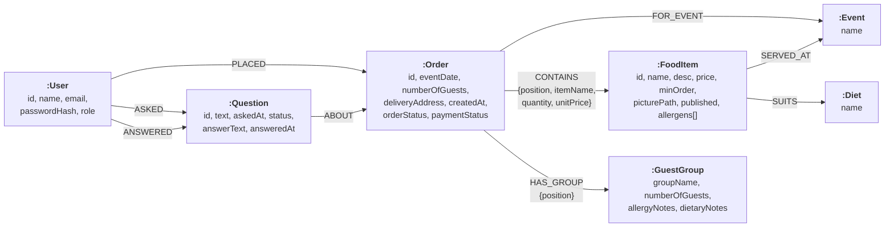

# Neo4j graph data model

How Ekte Mat Online stores its data in Neo4j. Boxes are nodes with their label and properties, and arrows are relationships. It replaces the SQLite tables: what were link tables (`food_item_event`, `food_item_diet`, `order_line`, `guest_group`) are now relationships or small nodes.

## Decisions
- **An order line is a relationship.** `CONTAINS` goes from the order to the food item and carries the quantity, plus the name and price from when the order was made. So an order keeps its prices when the menu changes.
- **Guest groups are nodes**, because an order has several and each has its own allergy and diet notes. Allergies are stored per group, not per named guest (GDPR note in the data pack).
- **A question's answer is stored on the question** (`answerText`, `answeredAt`), because there is at most one. Who answered is the `ANSWERED` relationship from the admin.
- **`position`** keeps order lines and guest groups in the order the customer added them, since relationships have no order of their own.
- **Allergens are a list property** on the food item. They are a fixed list (`ALLERGENS` in `app/models/food.py`) and nothing else points to them.
- **Prices are strings** (e.g. `"129.00"`), so `Decimal` keeps them exact. **Dates and times are ISO strings** (`"2027-05-22"`, `"2026-10-20T09:15:00"`), which sort correctly, so date filters work.

## Constraints
Created by `init_db()` in `app/models/db.py`:

| Label | Unique property |
|---|---|
| `User` | `id`, `email` |
| `FoodItem` | `id` |
| `Order` | `id` |
| `Question` | `id` |
| `Event` | `name` |
| `Diet` | `name` |

Neo4j has no foreign keys. The repositories find referenced nodes with `MATCH`, and raise `IntegrityError` when one is missing, so an order can't point to a food item that doesn't exist.
